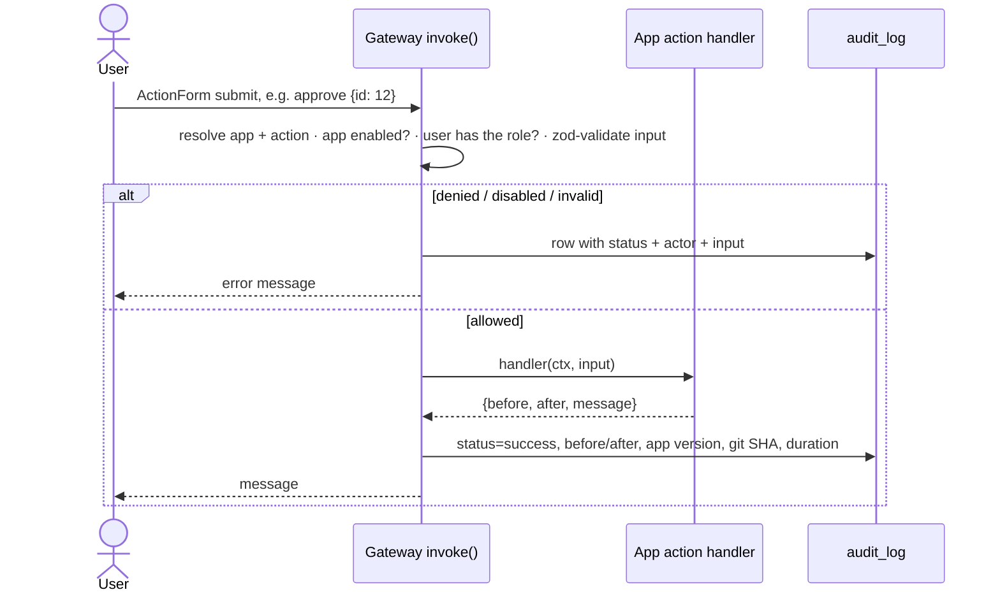

# Internal Apps Platform — Power Apps replacement POC

One Next.js/TypeScript repo where an internal app is a **folder** (`manifest.ts`, `schema.ts`, `actions.ts`, `page.tsx`) and the platform provides the parts Power Apps is actually valued for: **who can do what, an audit trail of every change, versions, environments and a kill switch**. New apps are generated by Devin from a short spec and land as reviewable PRs.

## Run it

Requires Node 22 and pnpm 10 (`npm i -g pnpm@10`). No Docker, no external services.

```bash
pnpm install
pnpm db:setup      # creates data/platform.db, applies migrations, seeds demo data
pnpm dev           # http://localhost:3000
```

Use the **"Signed in as"** dropdown (top right) to switch between demo users:

| User | Groups | Try |
|---|---|---|
| Priya | platform-admins | holds every role in every app |
| Marcus | kyc-reviewers | KYC: claim a case, approve/reject/escalate |
| Dana | kyc-reviewers, kyc-supervisors, refunds-leads | KYC: decide escalations · Refunds: approve large, mark paid |
| Omar | support, refunds-agents | Refunds: approve small, reject · Team Notes: post |
| Lena | auditors, kyc-viewers | read-only everywhere; can open Audit Log and Deployments |
| Sam | engineering | Feature Flags (toggle the kill switch), Deployments (promote); cannot see KYC or Refunds at all |

| Command | What it does |
|---|---|
| `pnpm check` | typecheck + `pnpm validate` (app conventions) + tests — what CI runs, minus lint and build |
| `pnpm new-app <slug> "<Name>" --owner <team> --entity <noun>` | scaffold and register a working app under `src/apps/<slug>` |
| `pnpm db:generate` / `pnpm db:reset` | new migration after a `schema.ts` change / wipe and reseed |
| `pnpm promote <app> <env>` | record a release in the deployments ledger |

**Two-minute demo.** As Omar, open *Refunds Dashboard*: approve Aisha (£49.99), reject Jonas with a reason, note the amber rows that need a lead. Switch to Dana: *Approve as lead* on Grace ($1,250), *Mark paid* on Daniel. Switch to Lena: *Audit Log* shows every step with before/after and the build SHA; *Deployments* shows which version of each app is live where. As Sam: *Feature Flags* → turn off `app:example-notes:enabled` and watch Team Notes grey out for everyone.

## How it works

Every write in every app goes through one function, `invoke(app, action, input)`:



Because the gateway is the only door, apps cannot forget to check permissions or to log, and anything wanted everywhere (rate limiting, approvals, idempotency) is added once. Denied, invalid, failed and disabled attempts are audited too — those are the rows compliance teams ask for. The gateway is a convention, so `pnpm validate` fails CI on DB writes from UI files, undeclared roles or actions, unregistered apps and cross-app imports.

**Power Apps → here.** App → `src/apps/<slug>/`. Solution → git commit + `manifest.ts` (name, version, owner). Environment → `deployments` rows (version + SHA per env). Security role / app sharing → manifest `roles` granted by directory groups, `viewRole` = "shared with". Flow / `OnSelect` → a named action. Dataverse table → `schema.ts` + migration. Maker studio → a Devin PR. Admin center → apps with `kind: "platform"` (Audit Log, Deployments, Feature Flags), same contract, listed separately, exempt from the kill switch.

**Identity.** Platform code only calls `getCurrentUser()` on an `IdentityProvider` seam (`src/platform/auth/provider.ts`); apps grant roles to *group names*. The mock provider reads a cookie set by the user switcher. Swapping in Entra ID (OIDC login, group claims → `groups`) is ~half a day and needs the client's tenant; nothing in the apps changes.

```
src/platform/   manifest.ts · auth/ (mock directory, provider seam) · authz/rbac.ts · actions/ (define, gateway, run) · audit/ · flags.ts · db/ · registry.ts · ui/ (shell, ActionForm/ActionButton)
src/apps/       example-notes (reference, ~120 lines) · feature-flags* · kyc-review · audit-log* · deployments* · refunds-dashboard      (* = kind: "platform")
src/app/        Next.js routes; /apps/[slug]/[[...path]] delegates to the app's Page
drizzle/        generated SQL migrations (schema is versioned with the apps)
scripts/        db-setup · validate (+ lib/validate-rules) · new-app (+ lib/scaffold) · promote
.devin/skills/new-internal-app/SKILL.md   the recipe Devin follows to turn a spec into an app PR
```

## Anatomy of an app

```ts
export const manifest = defineManifest({
  slug: "example-notes", name: "Team Notes", version: "1.0.0", owner: "platform-team", kind: "app",
  roles: {
    viewer: { description: "Can read notes",  groups: ["engineering", "support", "auditors"] },
    editor: { description: "Can post/delete", groups: ["engineering", "support"] },
  },
  viewRole: "viewer",
  actions: {
    postNote:   { description: "Post a note",   role: "editor" },
    deleteNote: { description: "Delete a note", role: "editor" },
  },
});
```

- `actions.ts`: one `action({ input: zodSchema, handler })` per manifest action. The handler gets `{ db, user, app, requestId }`, returns `{ before?, after?, entityId?, message? }` for the audit row, and throws `ActionError("…")` for business-rule failures (status `failed`). State machines (KYC, Refunds) live here as `expectStatus`-style guards.
- `schema.ts`: Drizzle tables prefixed `<slug>_`; run `pnpm db:generate` after changes.
- `page.tsx` (+ components): server components that *read* via Drizzle and render every mutation with `<ActionForm>` / `<ActionButton>`. `can(user, manifest, action)` only hides controls; the gateway is the check.
- `seed.ts`, `index.ts`, one line in `src/platform/registry.ts`, one in `src/db/schema.ts`.

Apps never import from each other or modify `src/platform/`.

## Creating a new app with Devin

Give a Devin session a spec ("Refunds dashboard for payments: queue of refund requests; agents approve/reject with a reason; leads approve amounts ≥ 500 and mark paid; auditors can view") and point it at `@skills:new-internal-app`. It scaffolds with `pnpm new-app`, shapes the code to the spec, runs `pnpm check` / `lint` / `build`, attaches screenshots and opens a PR; CI re-runs everything. The Refunds Dashboard in this repo was produced that way, from a 6-line spec, in about 12 minutes, with no platform changes.

## Apps

**Feature Flags** (`kind: platform`; `flag-admin` role = engineering). Named on/off switches with optional % rollout, read with `isFlagOn(key, userId?)`. A reserved flag per business app, `app:<slug>:enabled`, is the **kill switch**: off → the gateway refuses that app's actions (audited as `disabled`), the nav greys it out, users see a disabled notice, admins can still inspect. Platform apps have no switch so admins can never lock themselves out.

**KYC Review Queue.** Cases (customer, country, documents, risk 0–100) move `pending → in_review → approved | rejected | escalated`; risk ≥ 80 cannot be approved by a reviewer and must be escalated; supervisors (Dana) decide escalations, release others' cases and reopen. The case page is the audit log filtered by entity — no separate history table.

**Refunds Dashboard.** `requested → approved (approve, agent, < 500 | approveLarge, lead, ≥ 500) → paid (markPaid, lead)`, or `rejected` (agent, reason required). Threshold is nominal in the refund's own currency; amounts stored as integer cents. Leads are not implicitly agents (flat roles). Below 768px the table becomes a card list.

**Audit Log** (`kind: platform`, auditors). Read-only — no actions. Counts per outcome, filters (app, actor, action, status, date, free text), detail view with before/after diff and request id.

**Deployments** (`kind: platform`; viewers = engineering + auditors, `releaser` = engineering). App × environment matrix (dev/staging/prod) with version, SHA, "behind" highlight and history. `promote` records a release; nothing is actually deployed — it's the ledger CI should write to.

## Decision log

| # | Decision | Why / cost | Revisit when |
|---|---|---|---|
| 1 | Code-first apps + declarative manifest, not config-driven UI | Devin writes code well; a config DSL is a second platform with a ceiling. Cost: no runtime introspection / auto-forms | business users must edit apps without Devin |
| 2 | One repo, one deployable | 10× simpler to ~20 apps; blast radius bounded by kill switch + version pin | teams need independent release cadences |
| 3 | Flat roles granted by groups; platform admin holds all roles | Maps 1:1 to Entra groups, trivial to audit. Cost: leads aren't implicitly agents | an app needs row-level rules |
| 4 | Single action gateway for all writes | vs per-app routes + middleware (rewired per app, easy to forget audit), DB RLS/CDC (loses intent, never sees denials), edge gateway (HTTP only), OPA (still needs a choke point) | — |
| 5 | Handlers supply before/after; no CDC | CDC is heavy and loses intent. Cost: a handler can omit them (lint later) | compliance requires completeness |
| 6 | Audit denied/invalid/failed/disabled too | What security reviews ask for; cheap | volume |
| 7 | SQLite via Drizzle | Zero setup. Postgres = driver change + regenerated migrations | before any real deployment |
| 8 | Generated SQL migrations applied at startup | Versioned with apps, reviewable, tests run in-memory | — |
| 9 | Next.js server components + server actions | Least code; no separate API surface. Cost: Next-specific | a mobile/external client needs an API |
| 10 | Mock identity + user switcher behind an `IdentityProvider` seam; Entra not built | Demo-ability; real SSO needs the client's tenant (~0.5 day) | pilot with real users |
| 11 | Operational screens are apps with `kind: "platform"` | Same RBAC/audit/versioning for free; `kind` separates them in the shell and exempts them from the kill switch | — |
| 12 | Viewer apps read platform tables directly | Server-only, read-only; `viewRole` is the whole check | an API consumer appears |
| 13 | Promotion is a recorded event, not an orchestrated deploy | No deploy target in the POC; keeps "what is live where" answerable and audited | CI can write the ledger |
| 14 | Kill switch = reserved feature flag checked in the gateway | Reuses flags UI, RBAC, audit; instant, no redeploy | — |
| 15 | Workflow state machines in app handlers, not an engine | Each rule is a few lines next to the action; an engine is premature | long-running / multi-step approvals |
| 16 | Scaffold + validator instead of a visual builder | The maker is Devin; a builder recreates un-reviewable artifacts | — |
| 17 | Large-refund gate is a separate action (`approveLarge`) | Roles are per action, so the manifest alone says who may approve large; denials happen before any handler | — |

**Deliberately not built:** real SSO · row-level / attribute-based permissions · deploy approvals · multi-tenancy · visual builder · connectors beyond the platform DB · rate limiting · background jobs. Each has a home (gateway, connector layer, manifest).

## Roadmap

| # | Piece | PR |
|---|---|---|
| 1 | Platform core — manifest, identity seam, RBAC, gateway, audit, versions, shell, reference app, CI | [#1](https://github.com/RishabKalluri/cog_takehome/pull/1) |
| 2 | Feature flags + kill switch | [#2](https://github.com/RishabKalluri/cog_takehome/pull/2) |
| 3 | KYC review queue | [#5](https://github.com/RishabKalluri/cog_takehome/pull/5) |
| 4 | Audit-log viewer + deployments | [#4](https://github.com/RishabKalluri/cog_takehome/pull/4) |
| 5 | `pnpm new-app` scaffold, Devin skill, validator rules | [#3](https://github.com/RishabKalluri/cog_takehome/pull/3) |
| 6 | Platform vs business apps (`kind`) | [#6](https://github.com/RishabKalluri/cog_takehome/pull/6) |
| 7 | Refunds Dashboard, generated from the scaffold + skill | [#7](https://github.com/RishabKalluri/cog_takehome/pull/7) |

Next: Postgres, Entra ID login, lint that handlers return before/after, keep `ActionError` codes in the audit log, rate limiting + idempotency in the gateway.
