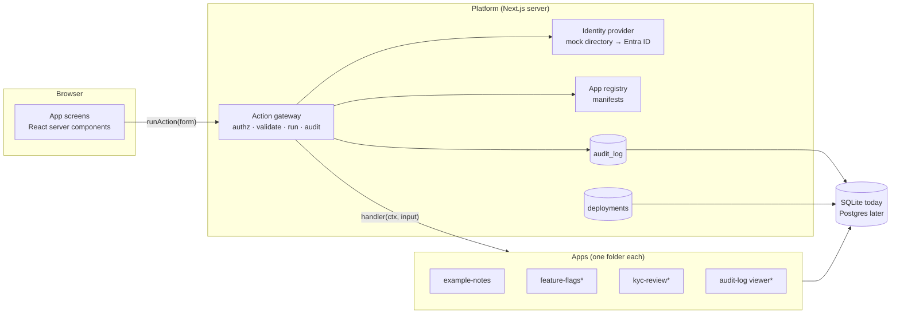
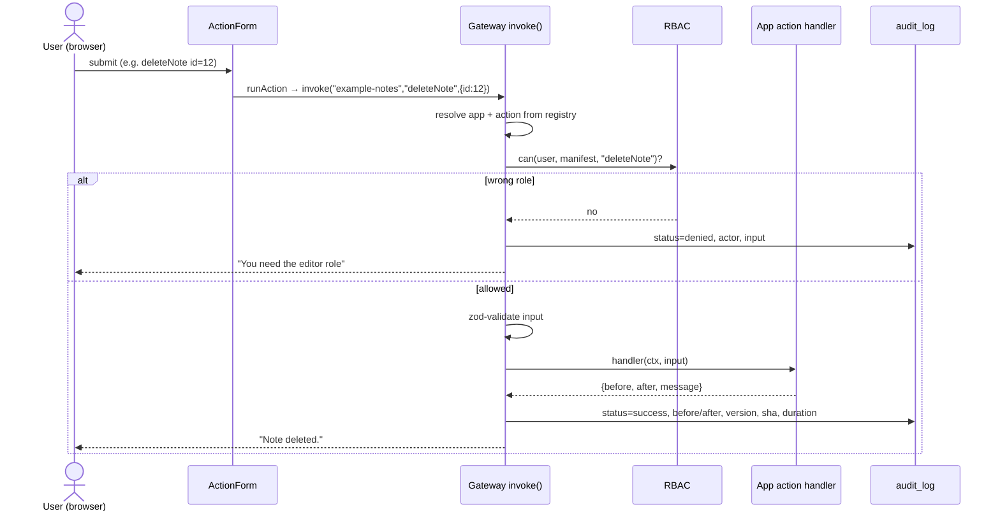

# Internal Apps Platform — Power Apps replacement POC

A small platform for building internal business apps (KYC review queue, refunds dashboard, feature-flag admin, …) where the hard, boring parts — **who can do what, an audit trail of every change, versions, environments, safe deploys** — are provided once by the platform, and each new app is just a folder that follows a few conventions. The folder is simple enough that Devin can generate a new app from a one-paragraph description.

> **Status:** built incrementally so each piece can be assessed. See [Roadmap](#roadmap) for what exists today.

---

## Table of contents

1. [Why not just use Power Apps?](#why-not-just-use-power-apps)
2. [What the platform gives every app (plain English)](#what-the-platform-gives-every-app)
3. [Quick start](#quick-start)
4. [Demo script](#demo-script)
5. [Architecture](#architecture)
6. [Anatomy of an app](#anatomy-of-an-app)
7. [Identity: mock today, Entra ID tomorrow](#identity-mock-today-entra-id-tomorrow)
8. [Decision log & tradeoffs](#decision-log--tradeoffs)
9. [Deliberately not built (yet)](#deliberately-not-built-yet)
10. [Roadmap](#roadmap)

---

## Why not just use Power Apps?

Power Apps is popular with business teams because a new app comes with login, permissions, an audit trail, versioning and environments *for free*. The drag-and-drop canvas is the least valuable part; the governance is the moat. Its costs are per-user licensing, vendor lock-in, apps that are hard to review/test/diff, and poor fit for anything that isn't a form over a table.

This POC keeps the governance and drops the canvas: apps are ordinary TypeScript/React code in one repo, reviewed as pull requests, tested in CI, and generated by Devin instead of dragged together by hand.

| Concern | Power Apps | This platform |
|---|---|---|
| Who builds apps | Business users with a canvas | Devin (or engineers) from a text spec, via PR |
| Login / identity | Entra ID built in | Pluggable; mock directory now, Entra ID via OIDC later |
| Permissions | Security roles on Dataverse tables | Roles declared per app, granted by directory groups, enforced server-side |
| Audit trail | Dataverse auditing (per table, opt-in) | Every action, every app, automatically — including *denied* attempts |
| Versioning | Solution versions, exported zips | Git. Each app has a semver; each build has a commit SHA shown in the UI |
| Environments / deploy | Dev → Test → Prod environments, managed solutions | Branch → CI → tagged release; `deployments` table records what is live where |
| Review / testing | Hard | Normal code review, unit tests, CI checks on every PR |
| Cost | Per-user/per-app licences | Hosting only |

### How an "app" here maps onto Power Apps concepts

Apps are **not** represented the way Power Apps represents them, but every Power Apps concept has a counterpart:

| Power Apps concept | What it is there | Counterpart here |
|---|---|---|
| App (canvas / model-driven) | A definition built in the maker studio, stored in Dataverse | A folder `src/apps/<slug>/` of ordinary TypeScript/React |
| Solution | Zip of app + tables + roles, exported/imported between environments | A git commit; the app's `manifest.ts` is the solution's metadata (name, version, owner) |
| Environment (dev / test / prod) | Separate Dataverse instance per stage | Same code deployed per stage; `deployments` table records which app version is live where |
| Security role + app sharing | Row/table privileges in Dataverse, app shared to groups | `roles` in the manifest, each granted by directory group; `viewRole` = "shared with" |
| Power Automate flow / button `OnSelect` | Logic attached to UI | A named *action* in `actions.ts`, callable only through the gateway |
| Dataverse table | Managed storage with optional auditing | `schema.ts` (Drizzle) with a migration; auditing is automatic for every action |
| Maker studio | Where humans drag controls | A PR authored by Devin from `AGENTS.md` + the reference app |

Honest note: Retool / Appsmith / Budibase are the off-the-shelf alternatives. The pitch here is *code you own*, generated on demand, with the same guarantees.

---

## What the platform gives every app

Written for someone who hasn't seen Power Apps' internals.

**An app is a folder.** `src/apps/<name>/` holds a manifest (what the app is, who may use it, what it can do), a database schema, the actions, and the screens. Nothing else is needed; the platform discovers it from the registry and puts it in the navigation.

**Roles, granted by groups.** Each app declares its roles (e.g. `reviewer`, `supervisor`) and which *directory groups* grant them (e.g. `kyc-reviewers`). Users carry groups, not app-specific permissions. In production the groups come from Entra ID, so IT keeps managing access exactly where they do today.

**Every change goes through one gate.** The only way to change data is to call a named *action* (`approveCase`, `toggleFlag`). The platform's gateway checks the user has the required role, validates the input, runs the action, and writes an audit row. An app cannot forget to check permissions or forget to log, because it never gets the chance.

**The audit log records intent, not just results.** Each row has who, what app and version, what action, the input, the record before and after, how long it took, and the outcome — including `denied` (wrong role), `invalid` (bad input) and `failed` (business rule, e.g. "case already claimed"). Denied attempts are the rows compliance teams actually want.

**You always know what's running.** Every screen shows the platform version, environment and git commit. Each app has its own version in its manifest. A `deployments` table records which version of which app is in dev/staging/prod.

**Try it as different people.** The top-right "Signed in as" dropdown shows who you are; picking another name impersonates mock users with different groups so permissions can be demonstrated in seconds. (Demo only; removed when real login is wired in.)

**Guardrails in CI.** `pnpm check` runs type-checking, the test suite, and `pnpm validate`, which fails the build if an app folder isn't registered, a manifest references an undeclared role, or an action is implemented without a declared role (and would therefore be unreachable).

---

## Quick start

```bash
pnpm install
pnpm db:setup      # creates data/platform.db, applies migrations, seeds demo data
pnpm dev           # http://localhost:3000
```

Other commands:

| Command | What it does |
|---|---|
| `pnpm check` | typecheck + validate + tests (what CI runs, minus build) |
| `pnpm validate` | app convention checks (see above) |
| `pnpm test` | vitest; gateway tests run against an in-memory SQLite |
| `pnpm db:generate` | after changing any `schema.ts`, produce a new migration in `drizzle/` |
| `pnpm db:reset` | wipe and reseed the local database |

Requirements: Node 22, pnpm 10+. No Docker, no external services.

---

## Demo script

1. Open the home page as **Priya (platform admin)** — she holds every role in every app.
2. Switch to **Lena (compliance auditor)**. She can *open* Team Notes but the post form disappears. Open DevTools → Network and submit a crafted request anyway? The gateway denies it and the denial is logged with her identity.
3. Switch to **Omar (support)** and post a note; delete it. Each is one audit row with before/after state.
4. Point at the footer: environment, build SHA, app versions.
5. Open `src/apps/example-notes/` — the whole app is ~120 lines. That folder is what Devin generates for a new app.

---

## Architecture

### System overview



`*` = planned, see [Roadmap](#roadmap).

### What happens when a user clicks a button



Three properties fall out of this design:

- **Permissions cannot be bypassed from the UI**, because the UI only ever posts to the gateway and the gateway re-checks everything server-side.
- **Logging cannot be forgotten**, because the gateway writes the audit row, not the app.
- **Apps stay small**, because the only thing an app must do is declare its actions and implement them.

### Repository layout

```
src/
  platform/               the reusable part — apps never modify this
    manifest.ts           zod schema for app manifests
    auth/                 users.ts (mock directory), provider.ts (IdentityProvider seam), switch-user.ts (demo)
    authz/rbac.ts         rolesFor / can / canView
    actions/
      define.ts           defineActions(), action(), ActionError — what apps import
      gateway.ts          invoke()/invokeAs(): the single choke point
      run.ts              server action bridging <ActionForm> to the gateway
    audit/log.ts          recordAudit / listAudit
    db/                   schema.ts (platform tables), client.ts (SQLite + migrations)
    registry.ts           the list of installed apps
    build-info.ts         git SHA, environment, platform version
    ui/                   shell (nav, user switcher), ActionForm/ActionButton, primitives
  apps/
    example-notes/        reference app: manifest.ts, schema.ts, actions.ts, page.tsx, seed.ts, index.ts
  app/                    Next.js routes: home, /apps/[slug]/[[...path]] → delegates to the app's Page
  db/schema.ts            aggregates platform + app tables for drizzle-kit
drizzle/                  generated SQL migrations (versioned schema)
scripts/                  db-setup, validate
.github/workflows/ci.yml  typecheck · lint · validate · test · build
```

---

## Anatomy of an app

The manifest is the only part the platform needs to understand:

```ts
export const manifest = defineManifest({
  slug: "example-notes",
  name: "Team Notes",
  version: "1.0.0",
  owner: "platform-team",
  roles: {
    viewer: { description: "Can read notes",  groups: ["engineering", "support", "auditors"] },
    editor: { description: "Can post/delete", groups: ["engineering", "support"] },
  },
  viewRole: "viewer",
  actions: {
    postNote:   { description: "Post a note",   role: "editor" },
    deleteNote: { description: "Delete a note", role: "editor" },
  },
});
```

Actions are tiny: a zod schema for the input plus a handler that receives `{ db, user, app, requestId }` and returns `{ before?, after?, entityId?, message? }` for the audit log. Throw `ActionError("…")` for expected business-rule failures; the message reaches the user and the row is logged as `failed`.

Screens are React server components. Any mutation is rendered with `<ActionForm app action>` or `<ActionButton …>`, which post to the gateway. Use `can(user, manifest, "action")` only to *hide* controls — the gateway is the real check.

Step-by-step "how to add an app" instructions (and the `pnpm new-app` scaffold + Devin skill) land in roadmap item 5.

### Audit log viewer

An ordinary app (`src/apps/audit-log/`) that happens to read the platform's own `audit_log` table. It is read-only — its manifest declares **no actions** — and is visible to the `auditors` group and platform admins (sign in as **Lena** or **Priya**).

What a compliance reviewer sees: a strip of counts per outcome (success / denied / invalid / failed / disabled) for the current filter, filters for app, actor, action, status, date range and a free-text search over entity and request ids (all in the URL, so a view can be bookmarked or pasted into a ticket), and a table of 50 rows per page, newest first. Clicking a row opens `/apps/audit-log/<id>` with every field, the action's input, and the record **before** and **after** pretty-printed, with changed fields highlighted and listed in a before/after table. Denied and failed attempts are first-class rows, which is the point: "who tried to do what they weren't allowed to" is one filter away.

On a fresh database, `pnpm db:setup` produces ~15 sample rows by calling the real gateway as different mock users (so they went through RBAC and validation like live traffic); they are back-dated and their request ids start with `seed-` so they are easy to tell apart.

### Deployments & versions

Also an app (`src/apps/deployments/`). The main screen is a matrix of **app × environment** (dev / staging / prod) showing the version, short commit SHA, when and by whom it was recorded; a cell is highlighted amber when the recorded version is older than the app's current manifest version ("prod is behind"). Clicking an app opens its full history at `/apps/deployments/<slug>`. The `viewer` role goes to engineering, auditors and admins; `releaser` (engineering, e.g. **Sam**) can also use the one action, `promote`.

What "promote" records: a new `deployments` row saying *the app's current manifest version, at this build's git SHA, is now live in environment X*, with optional notes — plus the normal audit row. It refuses to record the same version + SHA twice in one environment. `pnpm promote <app> <env> [notes]` writes the identical record from a terminal, credited to `cli:$USER`, so CI can call it as the last step of a real release.

Honest caveat: **nothing is deployed.** Real deploys are CI's job; this is the ledger of what CI (or a human) says is live, kept where the audit trail and the version numbers already are. If the ledger and reality disagree, the ledger is wrong — which is why CI should write it, not people.

---

## Identity: mock today, Entra ID tomorrow

**What Entra ID is.** Microsoft's identity service (formerly Azure AD). If the client runs Power Apps, their staff already sign in with it and their team memberships ("KYC-Reviewers") are Entra security groups.

**How the platform is shaped for it.** Two conventions, both zero-cost and good design regardless:

1. The platform only ever calls `getCurrentUser()` on an `IdentityProvider` interface (`src/platform/auth/provider.ts`). The mock reads a cookie set by the user switcher.
2. Apps grant roles to **group names**, never to individual users.

**What the real integration costs.** ~Half a day, and needs the client's tenant: register an app in Entra, implement the OIDC login flow (e.g. `next-auth` with the Microsoft Entra provider), map token claims (`oid`→id, `name`, `preferred_username`→email, `groups`→groups), and configure the group claim. No app code changes. Deliberately **not** done in the POC.

---

## Decision log & tradeoffs

Kept short and current. Newest at the bottom.

| # | Decision | Alternatives considered | Why | Revisit when |
|---|---|---|---|---|
| 1 | **Code-first apps with a declarative manifest** (hybrid) | Fully config-driven UI (JSON → rendered forms), like Power Apps | Devin writes code well; config DSLs are a second platform to build and always hit a ceiling. The manifest covers exactly what the platform must reason about (roles, actions, version). | Business users need to edit apps without Devin |
| 2 | **One repo, one deployable** | One service per app; micro-frontends | 10× simpler; fine to ~20 apps. Blast radius mitigated by per-app kill switch (roadmap 2) and version pinning. | Teams need independent release cadences or isolation for compliance |
| 3 | **Flat roles granted by groups**, platform admin holds all roles | Role hierarchies; ABAC / row-level security | Trivial to explain and audit; maps 1:1 onto Entra groups. | An app needs "reviewers may only see cases in their region" — add row filters in the connector layer |
| 4 | **Single action gateway** for all mutations — app code has no other way to write data | Per-app API routes + middleware (every app re-wires auth/logging, easy to forget); DB-level RLS + change-data-capture (unbypassable but loses intent and never sees denied attempts); edge API gateway (sees HTTP only, no before/after); policy engine such as OPA/Cedar (authz only, still needs a choke point) | Cheapest way to make authz, validation and audit impossible to skip; new cross-cutting rules (rate limits, approvals, kill switch) land once. Cost: it is a convention — enforced by `pnpm validate` and review — and long-running/bulk work needs extra design. | Never, this is the core bet; add OPA/ABAC *inside* it if rules get complex |
| 5 | **Audit stores before/after supplied by the handler** | Generic DB change-data-capture | CDC is infra-heavy and loses *intent*; handlers already have the row in hand. Cost: a handler can omit `before`/`after` — CI could lint for it later. | Audit completeness becomes a compliance requirement |
| 6 | **Audit rows for denied/invalid/failed attempts too** | Log successes only | Denials are what security reviews ask for; cheap. | Volume (then sample or ship to a log store) |
| 7 | **SQLite via Drizzle for the POC** | Postgres from day one | Zero setup for anyone cloning the repo; Drizzle keeps the schema/migrations portable. Switching is a connection-string and dialect change in `db/client.ts` + regenerating migrations. | Before any real deployment |
| 8 | **Schema changes as generated SQL migrations** (`drizzle/`), applied at startup | `drizzle-kit push` (no migration files) | Migrations are versioned alongside app versions and reviewable in PRs; also lets tests run in-memory. | — |
| 9 | **Next.js server components + server actions** | SPA + REST API | Least code; server-only data access means no API surface to secure separately. Cost: Next-specific. | A mobile client or external consumer needs an API — expose `invoke()` over HTTP |
| 10 | **Mock identity with a user switcher** | Stub OIDC server; real Entra | Demo-ability and zero setup; the `IdentityProvider` seam keeps the swap contained. | Pilot with real users |
| 11 | **Entra ID integration not built** | Build it now | Needs client tenant access; ~0.5 day; nothing in apps depends on it. | Client confirms Entra and provides a tenant |
| 12 | **Build the audit viewer and feature flags *as apps*** | Hard-code them into the platform | Dogfoods the model and proves platform apps aren't special. | — |
| 13 | **Viewer apps read platform tables directly, no API layer** (Audit Log and Deployments query `audit_log` / `deployments` with Drizzle from their server components) | An internal `/api/audit` layer; a repository/connector abstraction per table | Pages are server-only and read-only, so RBAC on the page (`viewRole`) is the whole access check; an API layer would be a second surface to secure for zero new capability. Cost: the apps couple to platform table shapes, so a schema change touches them. | A client outside this Next.js process needs the data, or row-level filtering of the audit trail per team |
| 14 | **Promotion is a recorded event, not an orchestrated deploy** (`promote` action and `pnpm promote` insert a `deployments` row with the manifest version + build SHA) | Have the platform trigger CI / run the deploy; infer deployments from CI webhooks | The POC has no deploy target; recording keeps the "what is live where" question answerable (and audited, including denied attempts) without pretending to ship code. CI already owns releases; it should call `pnpm promote` as its last step. | A real pipeline exists — wire CI to write the row, then consider making the UI button trigger the pipeline behind an approval |

---

## Deliberately not built (yet)

- Real SSO (see above) · row-level / attribute-based permissions · approval workflows for deploys · multi-tenancy · visual form builder · connectors beyond the platform DB · i18n · rate limiting · background jobs.
- Each has a natural home in the design (connector layer, gateway, manifest) and is listed in the decision log with a "revisit when".

---

## Roadmap

Built piece by piece so each can be assessed in isolation.

| # | Piece | What you can assess | Status |
|---|---|---|---|
| 1 | **Platform core** — manifest, identity seam + mock users, RBAC, action gateway, audit log, versions, shell UI, reference app, tests, CI | The security/governance model and how small an app is | ✅ this PR |
| 2 | **Feature-flags app** + per-app kill switch used by the shell | A real admin tool; platform dogfooding its own flags | planned |
| 3 | **KYC review queue** — claim / approve / reject / escalate with state machine and before/after audit | A workflow app, not CRUD; what the audit trail looks like under load | planned |
| 4 | **Audit-log viewer + deployments panel** | Compliance view; versions per environment | ✅ PR #__PR__ |
| 5 | **`pnpm new-app` scaffold, Devin skill, convention lints** | Generate the Refunds dashboard live with Devin | planned |

Pieces 2–5 are independent once 1 is merged and can be built in parallel (e.g. one Devin session each).
